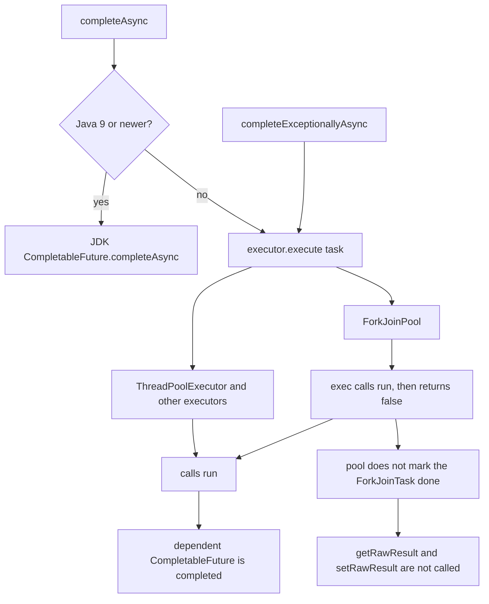

# Why `getRawResult` and `setRawResult` are not tested

Codecov shows four lines in [`ExecutionHelpers.java`](../cffu-core/src/main/java/io/foldright/cffu2/ExecutionHelpers.java) as uncovered: `getRawResult` and `setRawResult` on `CfCompleterBySupplier` and `CfExCompleterBySupplier`.

No code change, and no new test. Those lines stay uncovered.

## What these methods are

`ForkJoinTask` requires every subclass to implement three methods: `getRawResult`, `setRawResult`, and `exec`.

Both classes implement the first two as empty methods. `getRawResult` returns `null`. `setRawResult` ignores its argument. The real result is written to a dependent `CompletableFuture` inside `run()`.

```java
public Void getRawResult() { return null; }

public void setRawResult(Void v) {}

public boolean exec() {
    run();
    return false;
}
```

This shape comes from JDK `CompletableFuture.AsyncSupply` and `AsyncRun`. The classes are package-private. Application code does not call them.

## Who creates the tasks

The only callers are in [`CompletableFutureUtils`](../cffu-core/src/main/java/io/foldright/cffu2/CompletableFutureUtils.java):

- `completeAsync` builds a `CfCompleterBySupplier` only on Java 8. On Java 9 and newer it calls `CompletableFuture.completeAsync`, so this class is not created.
- `completeExceptionallyAsync` builds a `CfExCompleterBySupplier` on every supported JDK.

Both paths do the same thing with the task: `executor.execute(task)`. The task object is not returned, and nothing later joins it.

## What `exec()` returns

The return value is a signal to `ForkJoinPool`. It is not the business result of `run()`.

The pool runs a `ForkJoinTask` through `doExec()`:

```text
doExec:
    completed = exec()
    if exec throws:
        record an exceptional completion
    else if completed is true:
        mark the task normally complete and wake threads waiting in join or get
```

- `true` means "when `exec()` returns, this task has completed normally." `AdaptedRunnable` returns `true` because that adapter is the `Future` a caller joins. After `doExec()` marks it complete, `join()` reads `getRawResult()` and returns.
- `false` means "this task is not necessarily complete." `doExec()` leaves the status unfinished and skips the status update. A later `join()` waits until something else marks the task complete. The usual follow-up in the JDK is an explicit `complete` or `quietlyComplete`. These two classes never do that.
- An exception thrown by `exec()` is recorded as an abnormal completion. The boolean is not used. `run()` catches the supplier's exception and writes it to the `CompletableFuture`, so `exec()` normally does not throw.

`CfCompleterBySupplier` and `CfExCompleterBySupplier` always return `false`. `run()` has already stored the outcome in the dependent `CompletableFuture`. The `ForkJoinTask` is only a way to run that work in the pool. Nothing joins it, so marking the task complete would be a status update with no waiter.

`setDone()` on Java 21, and `setCompletion(NORMAL)` on Java 8, do not call `setRawResult`. Changing `return false` to `return true` still would not run these two methods. `getRawResult` runs only when something calls `join`, `get`, or `invoke` after the task is already completed normally.

## Java 8 and Java 21

The `doExec` rule is the same on both JDKs. The method name differs:

| JDK | When `exec()` returns `true` | Calls `setRawResult`? |
| --- | --- | --- |
| Java 8 | `setCompletion(NORMAL)` | No. It updates the status and notifies waiters. |
| Java 21 | `setDone()` | No. It sets the done bit and wakes waiters. |

On both JDKs:

- `ForkJoinTask.complete(V)` is what calls `setRawResult`, and then marks the task normally complete.
- `join()`, `get()`, and `invoke()` call `getRawResult` only after normal completion.

So the four lines stay unreachable on Java 8 and on Java 21. cffu never calls `complete` on these tasks, and it does not keep them for `join`.

One difference is inside the JDK itself, not in `doExec`:

- Java 8 `AsyncSupply.exec()` and `Completion.exec()` return `true`.
- Java 21 `AsyncSupply.exec()`, `AsyncRun.exec()`, and `Completion.exec()` return `false`.

cffu returns `false` on every JDK, including Java 8. That matches Java 21 `AsyncSupply`. It does not match Java 8 `AsyncSupply`.

The difference only changes the `ForkJoinTask` status. On Java 8, a `true` return makes `doExec` call `setCompletion(NORMAL)`. That still does not call `setRawResult`. Nothing joins the task, so `getRawResult` still does not run. The decision is the same on both JDKs.

## Why the existing tests do not reach them

[`CompletableFutureUtilsTest.test_write`](../cffu-core/src/test/java/io/foldright/cffu2/CompletableFutureUtilsTest.java) is the test for `completeAsync` and `completeExceptionallyAsync`. It checks the `CompletableFuture`: success, a supplier that throws, and a future that is already complete. It never sees the `ForkJoinTask`.



`executor.execute` is the whole library path:

- A `ForkJoinPool` notices that the object is a `ForkJoinTask`, so it calls `exec()`. `exec()` calls `run()` and returns `false`. The pool does not mark the task done, and it does not call `setRawResult`.
- A `ThreadPoolExecutor`, or any other plain `Executor`, calls `run()` because the task is a `Runnable`. `getRawResult` and `setRawResult` are not part of `Runnable`.

`run()` writes the supplier result, or the supplier exception, into the dependent `CompletableFuture`. If that future is already done, `run()` leaves it unchanged. That is the behavior `test_write` checks.

`setRawResult` is only entered from `ForkJoinTask.complete(V)`. `getRawResult` is only entered from `join`, `get`, or `invoke` after normal completion. With `exec()` returning `false`, the task never becomes complete, so `join()` would wait forever. The library does not keep the task, so that wait does not happen either.

Commit `e8cb37c` ("cover reachable Codecov gaps without reflection") added tests only for reachable lines. These four lines are not on the library path, so they stayed uncovered.

## Why we should not add a test

A test can touch the four lines. It still would not protect the behavior above.

The methods are `public`, because overriding `ForkJoinTask` widens `setRawResult` from `protected`. A test in the same package can construct the task and call both methods. No reflection is required. The test passes immediately. The only checks it can make are "`getRawResult` returns null" and "`setRawResult` does not throw." No production caller reads that return value. The test stays green if `completeAsync` stops completing the future, if a supplier exception is dropped, or if an already completed future is overwritten.

`task.complete(null)` followed by `join()` also runs the two methods. `complete` calls `setRawResult`, then marks the task done. `join` then calls `getRawResult`. That is the `ForkJoinTask` completion protocol. cffu does not use it for these tasks. The test would still pass if `run()` wrote the wrong outcome into the `CompletableFuture`.

The tradeoff is coverage against a useful failure. Either test turns the red lines green and can still miss a broken `completeAsync` or `completeExceptionallyAsync`. The behavior worth keeping a test for is already in `test_write`: the future completes with the supplier value, completes with the supplier exception, or stays unchanged when it was already done. Those cases run `run()`. When the executor is a `ForkJoinPool`, they also run `CfExCompleterBySupplier.exec()`.

Leave the four lines uncovered.
